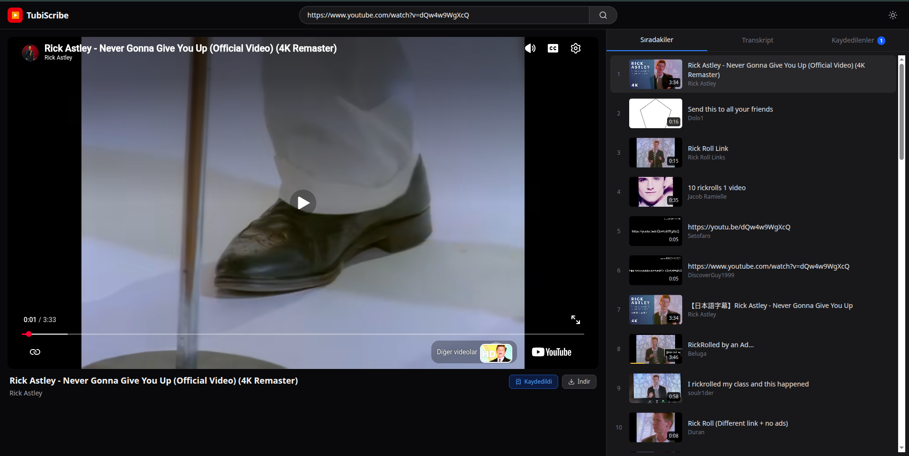
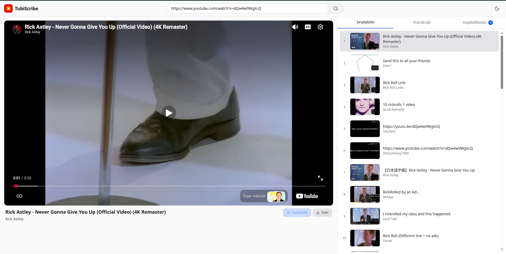
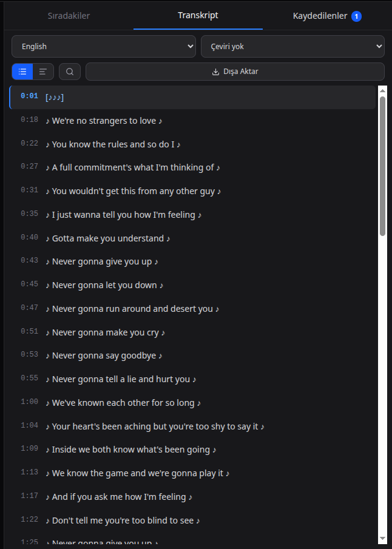
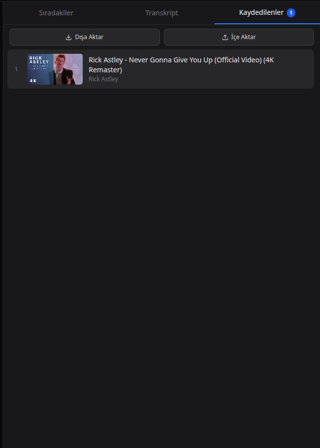

# TubiScribe

TubiScribe, YouTube videolarını reklamsız, izleyicisiz (tracker-free) ve tamamen gizlilik odaklı bir ortamda izlemenize olanak tanıyan gelişmiş bir masaüstü/web uygulamasıdır. İçerisinde barındırdığı akıllı transkript motoru, yüksek kaliteli medya indirici ve yerel veri yönetimi sayesinde standart bir video izleme deneyimini profesyonel bir araştırma ve arşivleme aracına dönüştürür.

---

## 📸 Ekran Görüntüleri

* 
* 
* 
* 
* 

---

## 🚀 Mevcut Özellikler (Neler Yapıldı?)

Uygulamanın şu anki V1.0 sürümünde tamamen çalışan, test edilmiş ve optimize edilmiş özellikler şunlardır:

### 1. Güvenlik ve İzole İzleme Deneyimi
* **Reklamsız ve Takipçisiz Altyapı:** Oynatıcı `youtube-nocookie.com` üzerinden çalıştırılarak üçüncü taraf reklam ve izleme çerezleri tamamen engellenmiştir.
* **CORS ve SSRF Koruması:** Sunucu taraflı istek sahteciliğine karşı katı URL filtrelemeleri eklenmiş, ağ erişimleri yerel ortamla (localhost) sınırlandırılmıştır.

### 2. Akıllı Transkript ve Çeviri Motoru
* **Anında Çeviri:** Videonun orijinal transkripti saniyeler içinde çekilebilir ve istenilen dile tek tıkla çevrilebilir.
* **Kelime Bazlı Arama (Ctrl+F):** Transkript içerisinde entegre arama yapılabilir, eşleşen kelimeler anlık olarak sarı renkle vurgulanır.
* **Senkronize Okuma:** Video oynatılırken okunan transkript satırı otomatik olarak belirginleşir ve kayar.
* **Önbellekleme (LRU Cache):** RAM üzerindeki bellek önbelleği sayesinde diller arası geçişlerde API bekleme süresi ortadan kaldırılmış ve saniyelik geçişler sağlanmıştır.

### 3. Yüksek Kaliteli Medya İndirme (FFmpeg)
* **Format Seçenekleri:** Görüntü ve sesin en yüksek kalitede birleştirildiği MP4 formatı veya sadece ses odaklı yüksek kaliteli MP3 formatı seçilebilir.
* **Arka Plan Görev Sistemi (Task Polling):** Dev boyutlu dosyalar indirilirken tarayıcı bağlantısı kopmaz (Timeout koruması). İndirme işlemi asenkron olarak çalışır ve kullanıcıya arayüzde ilerleme durumu (örneğin: %45) canlı olarak gösterilir.
* **Sayfa Korumalı İndirme:** İndirme işlemi görünmez bir "iframe" üzerinden tetiklenerek olası ağ hatalarında uygulamanın beyaz sayfaya düşmesi engellenir.

### 4. Arayüz ve Kullanıcı Deneyimi
* **Karanlık / Aydınlık Tema Geçişi:** Menü üzerinden tek tıkla anında tema değiştirilebilir, seçiminiz tarayıcı önbelleğine kaydedilir.
* **Klavye Kısayolları:** Tarayıcıda başka bir yere tıklamış olsanız dahi `Space` (Boşluk) tuşu ile videoyu durdurup başlatabilir, `Sağ/Sol Yön Tuşları` ile 5 saniye ileri veya geri sarabilirsiniz.
* **Yerel Veritabanı:** Kaydedilen videolar tarayıcının geçici hafızasında değil, arka planda çalışan güvenli bir JSON dosyasında tutulur. Başka cihazlara taşımak için içe/dışa aktarma (Import/Export) desteği mevcuttur.

---

## 🔮 Gelecek Planları (Neler Yapılacak?)

Uygulamayı bir sonraki seviyeye taşımak için planlanan V2.0 hedefleri aşağıda listelenmiştir:

* **Liste İndirme:** Oynatma listelerinin (playlist) içerisindeki videoların toplu olarak seçilip indirilmesi.
* **Shorts Video Entegrasyonu:** YouTube Shorts linklerinin ve formatlarının sisteme tam uyumlu hale getirilmesi.
* **Ana Menü Algoritması:** Uygulama açılış ekranında rastgele veya izleme geçmişine dayalı önerilen videoların sunulması.
* **Arama Çubuğu Önerileri:** Kullanıcı yazı yazarken otomatik tamamlama ve YouTube arama önerilerinin listelenmesi.
* **Çoklu Transkript Karşılaştırma (Çift Dilli Okuma Modu):** Dil öğrenenler için orijinal transkript ve çevirinin yan yana iki sütun halinde senkronize olarak gösterilmesi.
* **Yapay Zeka (AI) Video Özeti:** Uygulama içi yerleşik bir yapay zeka entegrasyonu ile uzun videoların transkriptinin analiz edilip saniyeler içinde madde madde özetlenmesi.
* **Kaldığın Yerden Devam Et (Akıllı Hafıza):** Kaydedilen bir videonun en son kaçıncı saniyede kapatıldığının hatırlanması ve tekrar açıldığında kaldığı yerden başlaması.
* **PDF veya Markdown Dışa Aktarma:** Transkriptlerin düz metin (TXT) yerine; video kapağı, başlıklar ve tıklanabilir zaman damgalarını barındıran şık doküman formatlarında indirilmesi.
* **PWA Desteği:** Uygulamanın bir masaüstü yazılımı gibi bilgisayara yüklenebilmesi ve çevrimdışı önbellek desteği.
* **Docker Compose Dağıtımı:** Tüm sistemin (frontend, backend, veritabanı) tek bir komutla herhangi bir sunucuya anında kurulabilmesi.

---

## 📁 Dosya Yapısı

Proje, bağımsız çalışan ancak birbiriyle iletişimde olan Frontend (React) ve Backend (FastAPI) mimarilerinden oluşmaktadır.

```text
TubeScribe/
├── backend/
│   ├── main.py                # FastAPI ana sunucusu, görev yönetimi ve API rotaları
│   ├── schemas.py             # Pydantic veri modelleri ve doğrulama şemaları
│   ├── requirements.txt       # Python kütüphane bağımlılıkları
│   ├── venv/                  # Python sanal ortamı (otomatik oluşturulur)
│   └── saved/                 # Kullanıcıya ait yerel JSON veritabanı klasörü
├── frontend/
│   ├── src/
│   │   ├── components/        # React arayüz bileşenleri (Navbar, Sidebar, VideoArea vb.)
│   │   ├── App.jsx            # Ana React uygulama bileşeni ve global durum yönetimi
│   │   ├── main.jsx           # React DOM render ve başlatma noktası
│   │   └── index.css          # Tailwind CSS v4 ayarları ve karanlık tema varyantları
│   ├── package.json           # Node.js bağımlılıkları ve npm komutları
│   └── vite.config.js         # Vite derleyici ayarları
├── docs/                      # Dökümantasyon ve ekran görüntüleri
│   ├── BACKEND_README.md      # Backend mimarisi ve API detayları
│   └── FRONTEND_README.md     # React arayüzü ve bileşen detayları
├── start.sh                   # Tüm sistemi kuran ve başlatan otomatik Linux betiği
├── OPTIMIZATIONS.md           # Sistem için hazırlanan detaylı performans/güvenlik raporu
└── README.md                  # Proje ana dökümantasyonu
```

> **Not:** Arka plan (Backend) ve ön yüz (Frontend) mimarilerinin kendi iç dinamikleri, API uç noktaları, manuel cURL testleri ve React yapıları hakkında çok daha detaylı teknik bilgi almak için lütfen [docs/BACKEND_README.md](docs/BACKEND_README.md) ve [docs/FRONTEND_README.md](docs/FRONTEND_README.md) dosyalarını inceleyin.

---

## ⚙️ Kurulum ve Çalıştırma

Uygulamayı çalıştırmak için bilgisayarınızda **Python 3.12+**, **Node.js** ve **FFmpeg** yüklü olmalıdır. Bunu iki farklı yöntemle yapabilirsiniz:

### Yöntem 1: Otomatik Çalıştırma (Önerilen - Sadece Linux)

Linux tabanlı bir dağıtım (Ubuntu, Debian, Fedora, Arch, openSUSE) kullanıyorsanız sistemdeki eksik gereksinimleri otomatik kuran betiği kullanabilirsiniz:

```bash
# Betiğe çalışma izni verin
chmod +x start.sh

# Uygulamayı başlatın
./start.sh
```

Bu komut Python sanal ortamını yaratır, kütüphaneleri indirir, npm paketlerini kurar ve hem arka planı hem de ön yüzü aynı anda başlatarak tarayıcınızda açar.

### Yöntem 2: Manuel Kurulum ve Çalıştırma (Tüm İşletim Sistemleri)

Eğer Windows/macOS kullanıyorsanız veya sistemleri ayrı terminallerde geliştirme modunda çalıştırmak istiyorsanız aşağıdaki adımları izleyin:

#### 1. Arka Planı (Backend) Başlatmak
Yeni bir terminal açın ve sırasıyla şu komutları girin:
```bash
cd backend
python3 -m venv venv
source venv/bin/activate      # Windows için: venv\Scripts\activate
pip install -r requirements.txt
uvicorn main:app --reload --port 8000
```

#### 2. Ön Yüzü (Frontend) Başlatmak
İkinci bir terminal açın ve sırasıyla şu komutları girin:
```bash
cd frontend
npm install
npm run dev
```

Terminalde beliren adrese (genellikle `http://localhost:5173`) tıklayarak uygulamayı kullanmaya başlayabilirsiniz.

---

## 📝 Kullanılan Teknolojiler

* **Geliştirme Çatısı:** React + Vite
* **Tasarım Sistemi:** Tailwind CSS v4 + Lucide React İkonları
* **Sunucu Mimarisi:** FastAPI (Python)
* **Video Veri Çıkarımı:** yt-dlp, youtube-transcript-api
* **Medya İşleme:** FFmpeg
* **Asenkron İletişim:** Axios

---

## 📄 Lisans

Bu proje açık kaynaklıdır ve MIT Lisansı (veya sizin belirleyeceğiniz bir lisans) altında özgürce kullanılabilir, geliştirilebilir ve dağıtılabilir. Katkıda bulunmak için depoyu çatallayabilir (fork) ve çekme istekleri (pull request) gönderebilirsiniz.